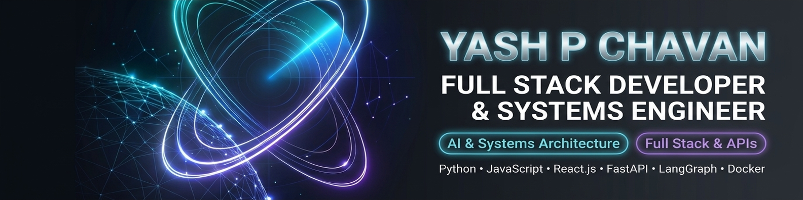

  

  
  
  
  

---

## 💫 About Me

* 🔭 **Currently working on:** **AegisCosmos** (3D satellite orbit & collision predictor), **SuryaJal™** (FAO-56 solar-aware agronomic digital twin), and [**Persona Chat AI**](https://github.com/Yash-Chavan-29/persona-chat-ai) (FastAPI + ChromaDB RAG agent)
* 🎓 **Education:** Bachelor of Computer Applications (B.C.A.) @ **KLE Technological University, Hubballi** *(Batch of 2027)*
* 👯 **Looking to collaborate on:** Full-Stack GenAI apps, real-time WebSocket systems, and competitive hackathons (**Hack Valley**, **Hack-A-Sol 5.0**)
* 🤝 **Looking for help with:** Scaling interactive 3D WebGL experiences, vector search optimization, and distributed backend architecture
* 🌱 **Currently learning:** Three.js / WebGL 3D, production Vector RAG pipelines, Docker, and system design
* 💬 **Ask me about:** Python, FastAPI, React.js, Node.js, ChromaDB, Socket.io, or Keplerian orbital mechanics
* ⚡ **Fun fact:** I turn complex math and late-night coffee into sub-50ms real-time apps and 3D space simulations 🚀

---

## 🚀 Featured Engineering Projects

| Project | Domain | Architecture & Key Impact | Core Stack |
| :--- | :--- | :--- | :--- |
| [**Persona Chat AI**](https://github.com/Yash-Chavan-29/persona-chat-ai) | GenAI / Vector RAG | FastAPI microservice parsing WhatsApp/Telegram logs into ChromaDB embeddings with PII redaction, Hinglish harmonization & realistic typing bursts. | `FastAPI` `ChromaDB` `Gemini 2.5` `Docker` |
| [**SuryaJal™ (ಸೂರ್ಯಜಲ)**](https://github.com/Yash-Chavan-29/SuryaJal) | AgriTech & CleanTech | Solar-aware FAO-56 soil hydrology digital twin with 5 real-time optimization engines, Gemini 2.5 Vision Scout & trilingual Indic voice copilot (`gTTS`). | `Python` `Streamlit` `Gemini Vision` `Plotly 3D` |
| [**Convoy Coordinator**](https://github.com/Yash-Chavan-29/Convoy-Coordinator) | Real-Time Systems | Multi-vehicle GPS telemetry sync (`<50ms` WebSocket broadcast), Mapbox GL route clustering, geo-fence alerts & shared expense ledger. | `React` `Socket.io` `Mapbox GL` `Capacitor` |
| [**EventHub**](https://github.com/Yash-Chavan-29/EventHub) | Full-Stack Web | Campus event ecosystem for discovery, registrations, RBAC organizer controls & QR attendance check-in built on MERN. | `React` `Node.js` `Express` `MongoDB` |
| **AegisCosmos** | Aerospace & 3D | *(Prototype planned)* Orbital trajectory & conjunction risk predictor applying Keplerian 2-body mechanics & SGP4 propagation in 3D coordinate space. | `Python` `NumPy` `Streamlit` `Plotly 3D` |
| **AI Presentation Generator** | GenAI Automation | Natural-language brief to structured PowerPoint (`.pptx`) & PDF deck pipeline powered by Google Gemini AI & PptxGenJS / Puppeteer. | `Gemini AI` `Node.js` `PptxGenJS` `Puppeteer` |
| **FITSync** | HealthTech & AI | Deterministic BMR/TDEE Mifflin-St Jeor nutrition calculator paired with Zod-validated Gemini meal & workout generation. | `React` `Express` `MongoDB` `Gemini` `Zod` |
| **Vortex Stores & EcoStream** | Full-Stack MERN & Mobile | Responsive gadget e-commerce platform (`Docker Compose`) and cross-platform Android audio streamer (`Capacitor`). | `MERN` `Docker` `Capacitor` `Tailwind` |

---

## 🏆 Hackathons & Highlights

* 🥇 **StarForge National Hackathon (BMSITM, Bengaluru):** Round 1 Finalist (**100/100 Technical Audit Score**)
* ⚡ **Team Lead @ Team Quantum Cosmic:** Directing system architecture, deterministic computation layers, and AI pair-programming sprints across national 24-hour & 36-hour hackathons (**Hack Valley**, **Hack-A-Sol 5.0**)

---

## 💻 Core Tech Stack

#### Programming Languages

#### AI, RAG & Scientific Computing

#### Full-Stack Web & Real-Time Systems

#### Databases, Cloud & DevOps

---

## 📊 GitHub Analytics

  
  

  

